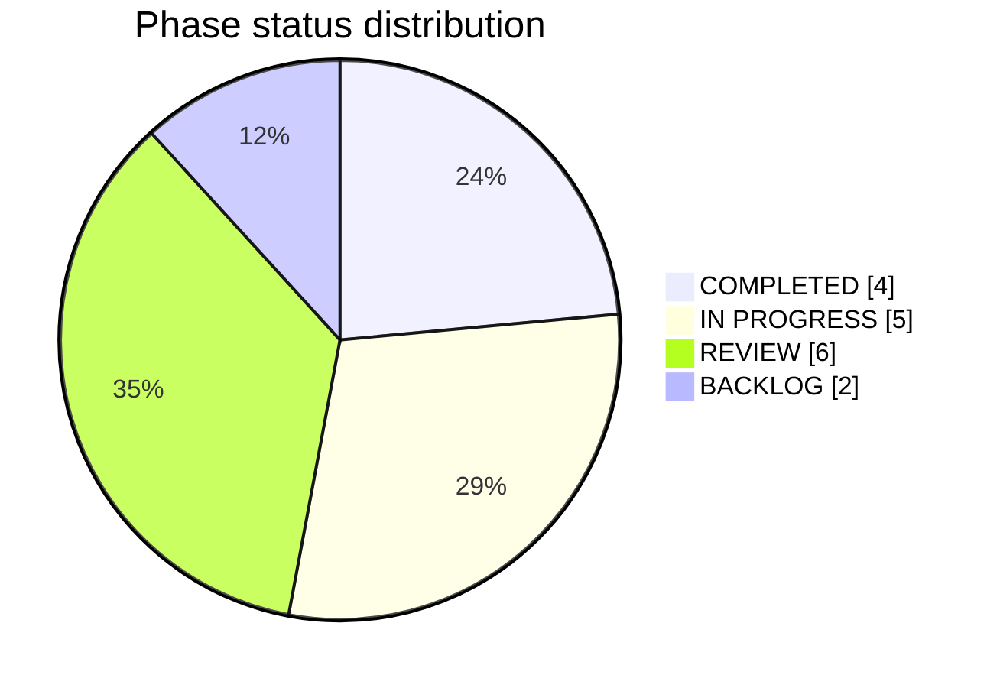

<!-- Generated from board/state.json. Do not edit by hand. -->

```text
=========================================================
       PAYROLL PLATFORM
              EXECUTION BOARD
=========================================================
```

Source: `board/state.json` · updated 2026-10-07

Overall progress: **41%** (33/81 tasks done)

## Project phases

```text
D0 MunshiPay discovery                     █████░░░░░  50%  REVIEW
P0 Engineering operating system            ██████████ 100%  COMPLETED
P1 Product foundation                      ██████████ 100%  COMPLETED
P2 Domain architecture                     ██████████ 100%  COMPLETED
P3 Identity and access                     ███████░░░  67%  IN PROGRESS
P4 Persistence and file storage            ░░░░░░░░░░   0%  BACKLOG
P5 Design system and shell                 ██████████ 100%  COMPLETED
P6 Company and masters                     ████████░░  80%  IN PROGRESS
P7 Workforce records                       ███░░░░░░░  29%  IN PROGRESS
P8 Compensation structures                 ██░░░░░░░░  17%  REVIEW
P9 Attendance, leave, and deductions       ████░░░░░░  38%  REVIEW
P10 Payroll engine                         █████░░░░░  50%  REVIEW
P11 Payroll operations                     ████░░░░░░  38%  IN PROGRESS
P12 Payslips, reports, and dashboard       ███░░░░░░░  30%  REVIEW
P13 Data exchange                          ██░░░░░░░░  17%  REVIEW
P14 Hardening                              ░░░░░░░░░░   0%  BACKLOG
P15 Release readiness                      █████░░░░░  50%  IN PROGRESS
```

## Phase status

Percentages are calculated from phase counts with the largest-remainder method.

| Status | Phases | Share |
| --- | ---: | ---: |
| COMPLETED | 4 | 23.5% |
| IN PROGRESS | 5 | 29.4% |
| REVIEW | 6 | 35.3% |
| BLOCKED | 0 | 0.0% |
| PLANNED | 0 | 0.0% |
| BACKLOG | 2 | 11.8% |



Statuses with a zero count are omitted from the chart and listed in the table.

## Areas

| Area | Tasks | Done | Active | Blocked | Progress |
| --- | ---: | ---: | ---: | ---: | ---: |
| Engineering OS | 1 | 1 | 0 | 0 | 100% |
| Foundation | 2 | 2 | 0 | 0 | 100% |
| Architecture | 1 | 1 | 0 | 0 | 100% |
| Authentication | 2 | 2 | 0 | 0 | 100% |
| Database | 6 | 0 | 0 | 0 | 0% |
| Design system | 1 | 1 | 0 | 0 | 100% |
| Frontend | 31 | 14 | 3 | 0 | 45% |
| Backend | 15 | 4 | 1 | 0 | 27% |
| Payroll engine | 7 | 2 | 2 | 0 | 29% |
| Reports | 7 | 1 | 1 | 0 | 14% |
| Security | 3 | 2 | 0 | 0 | 67% |
| Testing | 1 | 1 | 0 | 0 | 100% |
| DevOps | 2 | 1 | 0 | 0 | 50% |
| Documentation | 2 | 1 | 1 | 0 | 50% |

## AI model workload

Models are configured in `board/state.json`. Assignment is per task.

### Cursor Grok

- Export Excel
  - Task: `S-014`
  - Area: Backend
  - Phase: P13 Data exchange
  - Status: REVIEW
  - Started: 2026-10-07
  - Expected completion: 2026-10-07
  - Output: Export Excel at /app/exports downloads .xlsx workbooks: employee, salary rate master, month-wise salary (payable lines of the processed run), month-wise deduction, and custom employee and custom salary exports with a column picker. Salary rate and deduction exports use exactly the import columns, so a file can be edited and imported back. Amounts are rupee numbers with two decimals built from paise without floats, text is written as text so a formula is not run, and rows are sorted by code. Bank account, PAN, and Aadhaar are not offered in any export. Every download checks the session, the export right plus the view right of the screen that shows the same data, and reads only the session company. A refused download returns to the screen with the reason and keeps the chosen month and columns. The screen lists only the exports the role may download. Module: src/server/exports.ts, writer buildTableSheet in src/server/xlsx.ts, route /app/exports/download.
- Holiday entry
  - Task: `S-018`
  - Area: Frontend
  - Phase: P9 Attendance, leave, and deductions
  - Status: REVIEW
  - Started: 2026-10-07
  - Expected completion: —
  - Output: Holiday entry moved to /app/holidays with src/server/holidays.ts. Add requires a valid date and a four-digit year, refuses a duplicate date in the company, and writes an audit entry. Delete is confirmed and audited. The list filters by year and by text. The muster page starts public holiday at the number of listed dates in the month for rows not yet saved. The year is stored as typed and not checked against the date, because the reference does not show whether it is the calendar or financial year. Held in review: the desktop and phone browser check was not run.
- Deduction entry
  - Task: `S-027`
  - Area: Frontend
  - Phase: P9 Attendance, leave, and deductions
  - Status: REVIEW
  - Started: 2026-10-07
  - Expected completion: —
  - Output: src/server/deductions.ts adds, edits, and deletes deductions with audit entries that omit amounts. Types come from the Quick Entry list and are labels only. Amounts parse from text to paise and must be above zero. Edit and delete refuse a locked month. Deduction entry filters by month and type, lists month, year, employee code and name, type, and amount with a total, and keeps typed input after a refused save. New deductions still go to the header month because the reference Create screen was not visible. Older free-text types are shown as not in the list and must be changed to a listed type when edited. Held in review: the desktop and phone browser check was not run.
- Leave register and carry forward
  - Task: `S-035`
  - Area: Frontend
  - Phase: P9 Attendance, leave, and deductions
  - Status: REVIEW
  - Started: 2026-10-07
  - Expected completion: —
  - Output: src/server/leaveRegister.ts adds, edits, and deletes register rows with audit entries, one row per employee, year, and policy leave name. Days are typed with up to two decimals and the balance is not derived. Carry forward goes from a year to the next, creates only missing rows, never overwrites, and reports rows whose brought forward no longer matches. Leave register shows one line per employee for the year with a brought forward, this year, and balance group per policy leave name, flags repeated rows from older carry forwards and names not in the policy, and opens an employee's rows for edit and delete. Column groups use policy names because the reference's six bucket names wait on T-211. Encashment stays on the page unchanged for S-037. Held in review: the desktop and phone browser check was not run.
- Capture the reference screens the first pass could not open
  - Task: `T-211`
  - Area: Documentation
  - Phase: D0 MunshiPay discovery
  - Status: HUMAN REVIEW
  - Started: —
  - Expected completion: —
  - Output: —

### Cursor Fast

Idle.

### Claude Sonnet

- Salary slip
  - Task: `T-100`
  - Area: Reports
  - Phase: P12 Payslips, reports, and dashboard
  - Status: REVIEW
  - Started: 2026-10-07
  - Expected completion: —
  - Output: Salary slip with company, employee, payment, and paid-days details, an A4 print layout, and print of all or chosen slips

### Claude Opus

- Confirm statutory contribution rules
  - Task: `T-210`
  - Area: Payroll engine
  - Phase: P10 Payroll engine
  - Status: HUMAN REVIEW
  - Started: —
  - Expected completion: —
  - Output: —
- Confirm salary breakup and attendance pay rules
  - Task: `T-217`
  - Area: Payroll engine
  - Phase: P8 Compensation structures
  - Status: HUMAN REVIEW
  - Started: —
  - Expected completion: —
  - Output: —

## Testing queue

| Task | Phase | Agent | Test type | Status | Result | Failures | Required action |
| --- | --- | --- | --- | --- | --- | --- | --- |
| Document the observed MunshiPay functional map | D0 | Cursor Grok | Unit | PASS | Analysis contains the observed modules and omits live secrets and government identifiers | — | — |
| Build the engineering operating system | P0 | Cursor Grok | Unit | PASS | 3 passed: phase lifecycle, largest-remainder shares, dependency gating | — | — |
| Add repository hygiene and editor defaults | P1 | Cursor Fast | Unit | PASS | gitignore excludes .env and editor defaults set UTF-8 and LF | — | — |
| Scaffold the TypeScript application shell | P1 | Cursor Grok | Unit | PASS | Foundation page states features are not available and contains no pay figures | — | — |
| Scaffold the TypeScript application shell | P1 | Cursor Grok | Build | PASS | next build compiled the static home page | — | — |
| Scaffold the TypeScript application shell | P1 | Cursor Grok | Responsive | PASS | Home page readable at desktop and 375px with no horizontal overflow | — | — |
| Add lint, format, typecheck, and unit test scripts | P1 | Cursor Fast | Unit | PASS | package.json exposes lint, format, typecheck, and test; biome check passes | — | — |
| Add the environment contract without secrets | P1 | Cursor Fast | Unit | PASS | .env.example has empty values and no embedded credentials | — | — |
| Add the payroll calculation engine | P10 | Cursor Grok | Unit | PASS | 7 passed: split identity, PF cap, missing cap, per-day gross, blocked employees, adjustment | — | — |
| Process a month with exceptions and a lock | P11 | Cursor Grok | Unit | PASS | 4 passed: exception set, payable nets, lock rejection, viewer cannot add | — | — |
| Ship the payroll workspace | P5 | Cursor Grok | Build | PASS | next build compiled the sign-in page and the payroll routes | — | — |
| Record bounded contexts and module boundaries | P2 | Claude Opus | Unit | PASS | 8 passed in architecture tests: domain imports only domain, only actions and auth import next or react on the server, server and domain never import screens, client components import no server code, screens never write the store, only payroll calls the engine, only store and import touch the file system. Payroll tests pass after the muster move. | — | — |
| Define the role model and the menu-rights matrix | P3 | Claude Opus | Unit | PASS | 7 passed in access tests: every menu labelled and every report group mapped to its own menu, owner holds every right and viewer only view, a missing row is closed, reports need both rights, exports need both rights, the viewer cannot unlock, and an older store gains the new rows without changing existing ones. Architecture tests pass. Typecheck clean. | — | — |
| Replace the single environment login with stored users | P3 | Claude Opus | Unit | PASS | 5 passed in users tests: the first environment sign-in creates an owner of every company and a later environment password does not replace the hash, a viewer signs in as a viewer and only sees their companies, eight failures lock the username until the window passes including after a JSON round trip, a password change ends the previous session and the audit omits the password, and sign-in is unconfigured when the store has no user and no environment login. | — | — |
| Enforce view rights, company membership, and employee ownership | P3 | Claude Opus | Unit | PASS | 20 passed in src/server/rights.test.ts: a path takes the menu of its longest route, a role without view loses that menu's paths and a login without a role sees only the dashboard, every side menu item has a menu, every page under src/app/app calls requireView for its own menu and none reads data on a bare session, every route handler checks a right, the dashboard gates each section, every server action except sign-in and session ones is guarded, every remove and unlock action asks for delete, switchCompany and enterCompany use memberOf, memberOf is false for another company or an unknown company or user, and a loan, deduction, leave balance, encashment, or line adjustment for an employee of another company is refused and changes nothing | — | — |
| Enforce view rights, company membership, and employee ownership | P3 | Claude Opus | Build | PASS | next build passed. Typecheck, biome, and npm test (234) passed | — | — |
| Enforce view rights, company membership, and employee ownership | P3 | Claude Opus | UI | PASS | On a throwaway server with a viewer who has no payroll or loans view and belongs only to Northwind: Select Company listed one company, the side menu left out Process salary, Salary entry, Salary summary, Salary register, Salary slips, and Loans, and the dashboard showed no pay figures, run status, or process button. Opening the register, summary, a slip, and loans by URL returned no page content and sent the viewer to the dashboard with a permission message. A forged switch to Harbour Logistics was refused and the company stayed Northwind. The owner saw every menu item and every dashboard section. Page overflow at 406px was 0 | — | — |
| Sign in and company selection | P3 | Cursor Grok | Unit | PASS | Users tests cover membership-only company lists and a viewer who cannot open another company. Sign-in with an empty company is the path the Select Company page requires. | — | — |
| Sign in and company selection | P3 | Cursor Grok | UI | PASS | On a throwaway server, a wrong password showed User id or password is incorrect. The owner then saw Northwind Components and Harbour Logistics, search Harbour left only Harbour, Enter opened the Northwind dashboard, and Log out returned to sign-in. Overflow was 0 at 390px and 1440px. | — | — |
| Add error, not-found, and data-origin states | P5 | Cursor Fast | Unit | PASS | 2 passed: the sample seed is demo, a saved store and an older file without the flag are the company store, and the first save clears the demo label | — | — |
| Company list and sites | P6 | Cursor Grok | Unit | PASS | Creating a company keeps a viewer as viewer and gives an account owner the Owner role. A site stores the parent company. A blank name, a duplicate short name, and a creator who is not a member are refused and add nothing. Saving a short name another company already uses leaves the saved name unchanged. | — | — |
| Company list and sites | P6 | Cursor Grok | UI | PASS | An owner session's company list HTML included Company number, Short name, Northwind Components, Harbour Logistics, Gujarat, Maharashtra, Edit, Create company, and Create site. The profile HTML included Company number, Location, City, and Save company. | — | — |
| Company profile: identity, address, bank, and registration numbers | P6 | Claude Sonnet | Unit | PASS | 256 passed, 15 new. Domain: every reference field has a home, the field list and profile type agree, a blank profile holds no default, an older company gains blank fields, rates take three decimals from 0 to 100, a submitted profile parses to typed values, masked account, PAN, and TAN keep the saved value, bad pin code, email, phone, IFSC, PAN, TAN, dates, rates, amounts, radios, and long text are refused with the field named, and a logo is judged by its bytes. Server: the whole profile saves together and the audit holds no secret, a refused field or setting leaves the company and audit unchanged, a logo can be set, refused, kept, and removed, a new company starts blank, a new company or site is created with every profile field, logo, and setting, and a refused field creates nothing and leaves the audit unchanged. Architecture tests pass. | — | — |
| Company profile: identity, address, bank, and registration numbers | P6 | Claude Sonnet | Build | PASS | next build compiled /app/company, /app/company/new, and /app/company/profile. Typecheck and biome check clean. | — | — |
| Company profile: identity, address, bank, and registration numbers | P6 | Claude Sonnet | UI | PASS | In a browser as the owner of Northwind: filled address, email, phone, district, pin code, IFSC, account, PAN, A/C-2 percent and minimum, PF and ESI radios, ESI on OT, and a logo, then saved. The notice showed, values persisted, IFSC was uppercased, the account and PAN showed masked, and the logo displayed. Saving again with the masked values untouched was accepted. A pin code of 12 was refused with the message, the other typed values were kept, and the address held no account or PAN. No console errors. | — | — |
| Company profile: identity, address, bank, and registration numbers | P6 | Claude Sonnet | UI | PASS | In a browser as an admin of Harbour: opened Create company, entered identity, district, PF and ESI settings, and a bad PAN. The page returned with the message and every typed value kept, and the PAN cleared. After correcting the PAN and adding an IFSC in lower case, the company was created: the store held the district, the upper-cased IFSC, the PAN, PF number, PF percent 12, and ESI limit 21000 rupees in paise, and the audit entry named the short name only. Create site created a site under the current company with professional tax on. Create site and Create company buttons show on the company list only with the add right. | — | — |
| Company profile: identity, address, bank, and registration numbers | P6 | Claude Sonnet | Responsive | PASS | Page overflow was 0 at 390, 768, 1440, and 1920. The sections stack on a phone, sit in two columns from 1180, and three from 1700, and the save bar stays reachable. | — | — |
| PT master | P6 | Cursor Grok | Unit | PASS | 9 passed in slabs tests: paise parsing, add/edit/delete audit, validation, company and viewer rights, as-on selection, inclusive limits with overlap and gap, overlap warning scope, revised set in processing, locked month unchanged | — | — |
| Misc. entry | P6 | Cursor Grok | Unit | PASS | 11 passed in src/server/misc.test.ts: add rules, unchanged store after a refusal, usage counts per company, rename moves employees, bank rename moves salary and PF bank, delete refused while used, other-company entry refused, listed-value check for employee forms | — | — |
| Misc. entry | P6 | Cursor Grok | Build | PASS | next build compiled /app/misc and typecheck passed | — | — |
| Misc. entry | P6 | Cursor Grok | Responsive | PASS | At 406px /app/misc has no horizontal overflow. In the browser a repeated name was refused with the input kept, add worked, rename moved the employee, and the profile showed list pickers | — | — |
| Employees | P7 | Cursor Grok | Unit | PASS | 2 passed: page size, employment, and sort stay on the allowed values; delete refuses a processed employee and removes one who was never processed | — | — |
| Employee profile (create and edit) | P7 | Cursor Grok | Unit | PASS | 12 passed in src/domain/employeeFields.test.ts (built full name, next code keeps prefix and padding and is never a used code, case-blind code match, masking keeps four characters and the length, untouched mask keeps the saved value, typed or cleared value replaces it, real calendar dates) and 12 passed in src/server/employeeProfile.test.ts (next code per company, name built from parts, own PF and ESI flags and defaults, no duplicate code, every refusal leaves the store and audit untouched, audit holds the code and no values, masked identity kept, typed or cleared identity replaced, extra fields recorded, blank join date kept, other company refused) | — | — |
| Employee profile (create and edit) | P7 | Cursor Grok | Build | PASS | next build compiled /app/employees/new and /app/employees/[id]. Typecheck and biome on src passed | — | — |
| Employee profile (create and edit) | P7 | Cursor Grok | Responsive | PASS | At 406px /app/employees/new and the profile tab have no horizontal overflow. In the browser the new page showed E007 read-only, a name of spaces was refused with the typed join date, mobile, and ESI choice kept, and a valid save went to the new employee Meera Nair, after which the new page showed E008. On the profile tab Aadhaar, PAN, and account showed as XXXXXXXX1234, XXXXXX234F, and XXXXXX3344 and the full values were not in the page HTML. Saving again with the masks untouched kept the stored values, and the audit entries held no values | — | — |
| Set percentage | P8 | Cursor Grok | Unit | PASS | 11 passed in src/server/categories.test.ts: percent parsing table, basic plus DA at 100 and 100.01, name rules, unchanged store after a refusal, edit keeps the list, other-company category refused, delete refused while salary rows use it, locked month unchanged by an edit | — | — |
| Set percentage | P8 | Cursor Grok | Build | PASS | next build compiled /app/percentages and typecheck passed | — | — |
| Set percentage | P8 | Cursor Grok | Responsive | PASS | At 406px the page has no horizontal overflow. Refused save keeps the typed values, add, delete confirmation, and edit prefill worked in the browser | — | — |
| Holiday entry | P9 | Cursor Grok | Unit | PASS | 7 passed in holidays tests: add with year and audit, invalid and duplicate refused, same date in two companies, delete scoped to company, search by year and text, muster count per month, legacy year backfill | — | — |
| Holiday entry | P9 | Cursor Grok | Build | PASS | next build compiled /app/holidays, /app/muster, and /app/masters | — | — |
| Shift master | P9 | Cursor Grok | Unit | PASS | 12 passed in src/server/shifts.test.ts: hours table, time format and pair rules, name rules, unchanged store after a refusal, per-company names, rename moves employees, delete refused while used, other-company shift refused, older records without the new fields, listed-shift check | — | — |
| Shift master | P9 | Cursor Grok | Build | PASS | next build compiled /app/shifts and typecheck passed | — | — |
| Shift master | P9 | Cursor Grok | Responsive | PASS | At 406px /app/shifts has no horizontal overflow. In the browser an incomplete time pair was refused with the input kept, add worked, an older shift opened for edit, a rename moved six employees, and the Other tab showed the shift picker | — | — |
| Loan entry | P9 | Cursor Grok | Unit | PASS | 5 passed in loan tests: add edit delete audit without amounts, validation, company and viewer rights, lock posts the installment until the balance is zero, unlock restores it, a posted loan cannot be deleted | — | — |
| Deduction entry | P9 | Cursor Grok | Unit | PASS | 9 passed in deductions tests: paise parsing, listed types, add with audit that omits amount, invalid input refused, edit and delete with audit, locked month refuses edit, delete, and add then allows after unlock, company scope, month and type filter, processing uses edited and deleted rows | — | — |
| Deduction entry | P9 | Cursor Grok | Build | PASS | next build compiled /app/deductions | — | — |
| Leave policy | P9 | Cursor Grok | Unit | PASS | 11 passed in src/server/leavePolicy.test.ts: required cadre and name, field length, duplicate cadre and name pair per company, unchanged store after a refusal, per-company policies, rename cascades to balances and encashments, no cascade when another policy shares the name, delete refused while records use the name, delete allowed when a sibling policy keeps the name, other-company policy refused, audit entries | — | — |
| Leave policy | P9 | Cursor Grok | Build | PASS | next build compiled /app/leave and /app/leave-policy and typecheck passed | — | — |
| Leave policy | P9 | Cursor Grok | Responsive | PASS | At 406px /app/leave-policy has no horizontal overflow. In the browser a duplicate cadre and name pair was refused with the input kept, a Worker policy was added, the seeded Staff policy opened prefilled, and renaming it moved the leave register row to the new name. The in-use policy showed no delete link, and the nav highlighted only Leave policy | — | — |
| Leave register and carry forward | P9 | Cursor Grok | Unit | PASS | 9 passed in leaveRegister tests: day parsing, policy leave names, add as typed with audit, invalid, unlisted, and duplicate rows refused, edit and delete scoped to company with audit, carry forward safe to repeat, never overwrites and reports a changed balance, adds only missing rows within the company, register grouping with repeats and unlisted names | — | — |
| Leave register and carry forward | P9 | Cursor Grok | Build | PASS | next build compiled /app/leave | — | — |
| Test the money helpers and record the rounding policy | P10 | Cursor Grok | Unit | PASS | 5 passed in money tests: half-away-from-zero cases including negatives and no negative zero, the 1.15 percent and 1.005 float traps, refusal of out-of-range, three-decimal, non-finite, fractional, and oversized inputs, rupee and percent text parsing, plainRupees round trip, and Indian grouping. Category percent table and engine tests pass unchanged. | — | — |
| Test the money helpers and record the rounding policy | P10 | Cursor Grok | UI | PASS | On a throwaway store, PF percent 101, PF limit 12.345, gross 12.345, earning adjustment 1.005, and encashment -1 each showed the field error and saved nothing. | — | — |
| Enforce the period lock on muster and deduction edits | P11 | Claude Opus | Unit | PASS | 8 passed in payroll tests: locked month rejects muster and deduction writes and leaves them unchanged, both accepted after unlock, next month stays open, another company's employee rejected | — | — |
| Enforce the period lock on muster and deduction edits | P11 | Claude Opus | Build | PASS | next build compiled /app/muster and /app/deductions | — | — |
| Post loan installments when a month is locked | P11 | Cursor Grok | Unit | PASS | Lock posts each company loan until the balance is zero and the next month deducts nothing. Unlock restores that month only. Audit lines name the month and omit amounts. | — | — |
| Salary slip | P12 | Claude Sonnet | Unit | PASS | 11 passed in src/server/slips.test.ts: company, employee, payment, paid days, and month on the slip; earnings before deductions matching the saved totals; a labeled adjustment row with totals still matching; read from the saved line; blank paid days; payment labels; no slip for an unpayable line, an unprocessed month, or another company; run order; all or chosen slips; selection trimmed, de-duplicated, and capped; store unchanged | — | — |
| Salary slip | P12 | Claude Sonnet | Build | PASS | next build compiled /app/payroll/slips, /app/payroll/slips/[employeeId], and /app/payroll/slips/print. Typecheck and biome passed | — | — |
| Salary slip | P12 | Claude Sonnet | Responsive | PASS | At 406px the slip has no horizontal overflow and shows its facts in one column. In the browser, ticking two employees printed two slips, Print all printed three, a repeated, unknown, unpayable, or other-company id was dropped, and no choice showed a prompt. With print media emulated the menu, top bar, and page controls were hidden and the slip showed in two columns on a white page. Only the Salary slips menu item is marked current on the slip pages | — | — |
| Report list and report framework | P12 | Cursor Grok | Unit | PASS | 16 passed in src/server/reports.test.ts: ten reports in reference groups, row and column counts match, only payable lines, per-company rows, per-report columns, no pay rows for an unprocessed month, run status, muster and leave and leaver rows, IT declaration has nothing to list, CSV equals the screen rows in plain rupees, CSV differs per report, formula and quote escaping, store unchanged, exact plain rupees, month and date validation | — | — |
| Report list and report framework | P12 | Cursor Grok | Build | PASS | next build compiled /app/reports, /app/reports/[slug], and /app/export. Typecheck, biome, and npm test (146) passed | — | — |
| Report list and report framework | P12 | Cursor Grok | Responsive | PASS | At 406px /app/reports has no horizontal overflow. In the browser the catalog showed six groups with status, row count, and Demo origin per report. After processing October the register listed three payable lines and every download matched its report. A September filter showed the empty state, a bad month or payment date was refused with a message, the IT declaration had no download, and an unknown kind or slug returned 400 or 404 | — | — |
| Dashboard | P12 | Cursor Grok | Unit | PASS | 2 passed: pending counts skip other companies, leavers, and filled fields; events use a 30-day window including year-end and 29 February | — | — |
| Import Excel: upload, preview, and rejection report | P13 | Cursor Grok | Unit | PASS | 3 passed: wrong file and leave flow refused, rejected rows block save, accepted rows save for one company with one audit entry | — | — |
| Export Excel | P13 | Cursor Grok | Unit | PASS | 9 passed in exports tests: unique slugs on real menus; no bank account, PAN, or Aadhaar column and none of those values in a full custom export; employee export limited to the company and sorted; month-wise salary has only payable lines of the company's run in paise; missing run and invalid months refused; custom columns kept in catalog order with unknown and empty choices refused; deduction export uses the import columns and the company's month; a salary rate workbook reads back and passes the salary rate import with 42500.05 exact; formula-like text stays a string cell. Architecture and import tests pass. Typecheck clean. | — | — |
| Add the continuous integration pipeline | P15 | Cursor Fast | Unit | PASS | The workflow file triggers on push and pull_request and runs npm ci, lint, typecheck, test, board:check, and build. | — | — |
| Dashboard: gross to net, trend, deductions, distribution, filters, and drill-downs | P12 | Claude Sonnet | Unit | PASS | 263 passed, 7 new for src/domain/dashboardStats.ts. Gross, deductions and net balance on every line and reconcile() reports any that do not. PF takes the basic pay up to the PF limit (basic 20,000 against a 15,000 limit gives 1,800) and ESI takes its percent of the ESI wage (0.75% of 40,000 gives 300), both with test percents in a temporary store only. A deduction adjustment is counted once, which fixes a double count the dashboard donut had. The waterfall ends at net, department totals add up to the whole, pay bands return nothing under five people, and the insights state only facts present in the lines. | — | — |
| Dashboard: gross to net, trend, deductions, distribution, filters, and drill-downs | P12 | Claude Sonnet | Build | PASS | next build succeeded. Biome check and typecheck are clean. | — | — |
| Dashboard: gross to net, trend, deductions, distribution, filters, and drill-downs | P12 | Claude Sonnet | UI | PASS | In a browser against a temporary copy of the store with August, September and October 2026 processed: the trend tooltip shows gross, deductions, net and the month-on-month change, legend toggles hide series, Fit to range rescales the axis with labelled ticks, choosing a month chip switches the period and every figure follows. The deduction donut highlights and drills into the people behind PF, and zero parts are disabled with a reason. Pay bands drill into the people in a band. Choosing a department from the bar chart filters every figure, and the filtered gross, deductions and net match the department lines. A month with no processed run shows an empty state in each chart, and no chart is blank or invented. No console errors. | — | — |
| Dashboard: gross to net, trend, deductions, distribution, filters, and drill-downs | P12 | Claude Sonnet | Responsive | PASS | Page overflow was 0 at 320, 390, 768 and 1440. The Gross to net table drops its running total and wraps on a phone, and the trend, donut and band controls stay reachable. | — | — |

## Kanban

| BACKLOG | TODO | IN PROGRESS | REVIEW | BLOCKED | DONE |
| --- | --- | --- | --- | --- | --- |
| S-029 Process salary |   |   | T-210 Confirm statutory contribution rules (human) |   | T-001 Build the engineering operating system |
| T-110 Review tenant isolation, authorization, and sensitive-data handling |   |   | T-217 Confirm salary breakup and attendance pay rules (human) |   | T-002 Document the observed MunshiPay functional map |
| S-009 Employee other details |   |   | S-014 Export Excel |   | T-010 Add repository hygiene and editor defaults |
| S-010 Employee salary history |   |   | S-018 Holiday entry |   | T-011 Scaffold the TypeScript application shell |
| S-011 Nominees |   |   | S-027 Deduction entry |   | T-012 Add lint, format, typecheck, and unit test scripts |
| S-012 Documents |   |   | S-035 Leave register and carry forward |   | T-013 Add the environment contract without secrets |
| S-025 Monthly muster |   |   | T-100 Salary slip |   | T-030 Define the role model and the menu-rights matrix |
| S-028 Salary summary |   |   | T-211 Capture the reference screens the first pass could not open (human) |   | T-031 Replace the single environment login with stored users |
| S-030 Salary entry |   |   |   |   | T-032 Enforce view rights, company membership, and employee ownership |
| S-041 User master |   |   |   |   | T-200 Add the payroll calculation engine |
| S-042 User roles and menu rights |   |   |   |   | T-201 Process a month with exceptions and a lock |
| S-044 Data lock |   |   |   |   | T-202 Ship the payroll workspace |
| T-040 Add organization, company, and membership schema |   |   |   |   | T-218 Enforce the period lock on muster and deduction edits |
| T-041 Add the forward-only migration workflow |   |   |   |   | S-001 Sign in and company selection |
| T-071 Configurable earning and deduction heads |   |   |   |   | S-004 Dashboard |
| T-081 Calculate PF, ESI, and PT from the confirmed rules |   |   |   |   | S-005 Company list and sites |
| T-111 Pass responsive and accessibility checks on built screens |   |   |   |   | S-006 Employees |
| T-112 Review pagination and indexes |   |   |   |   | S-008 Employee profile (create and edit) |
| T-213 Move company, employee, and master records to PostgreSQL |   |   |   |   | S-013 Import Excel: upload, preview, and rejection report |
| T-214 Move attendance, leave, loan, and deduction records to PostgreSQL |   |   |   |   | S-015 Set percentage |
| T-215 Move payroll runs, locks, and audit to PostgreSQL with an input snapshot |   |   |   |   | S-016 PT master |
| T-216 Store employee documents on Bunny Storage |   |   |   |   | S-017 Misc. entry |
| T-220 Salary reports beyond the register |   |   |   |   | S-024 Shift master |
| T-221 PF reports |   |   |   |   | S-026 Loan entry |
| T-222 ESI reports |   |   |   |   | S-034 Leave policy |
| T-223 Professional tax and income-tax reports |   |   |   |   | S-039 Report list and report framework |
| T-226 Import employees |   |   |   |   | T-020 Record bounded contexts and module boundaries |
| T-227 Import salary rates |   |   |   |   | T-051 Add error, not-found, and data-origin states |
| T-228 Import monthly attendance |   |   |   |   | T-080 Test the money helpers and record the rounding policy |
| T-230 Break an employee's salary into the configured heads |   |   |   |   | T-121 Add the continuous integration pipeline |
| S-023 Rate change |   |   |   |   | T-212 Company profile: identity, address, bank, and registration numbers |
| S-032 F&F settlement |   |   |   |   | T-219 Post loan installments when a month is locked |
| S-037 Leave encashment |   |   |   |   | T-232 Dashboard: gross to net, trend, deductions, distribution, filters, and drill-downs |
| S-046 Transfer employee |   |   |   |   |   |
| S-047 Merge employee code |   |   |   |   |   |
| T-120 Write the deployment checklist |   |   |   |   |   |
| T-224 Workforce, attendance, and leave reports |   |   |   |   |   |
| T-225 Email payslips |   |   |   |   |   |
| T-229 Import deductions, nominees, and leave opening balances |   |   |   |   |   |
| T-231 Company owners, salary-slip email sender, and document bucket |   |   |   |   |   |

## Human review required

### Capture the reference screens the first pass could not open

- Why human input is required: Create forms for shift, loan, deduction, leave policy, and leave encashment were unauthorized. Several screens were listed but not opened.
- What the agent could not determine: Muster day-cell codes. Meaning of MD, WD, PD, CF, and OD, and whether Quick Entry feeds Process Salary. Leave Master contents. Names of the six leave-register buckets. Salary Entry edit form. Full and Final worksheet. Family List columns. Misc. Entry type labels. Company option lists for Pay Scale On, Leave Method, PF Cal., and ESI Cal. Layouts and file formats of the PF, ESI, and PT reports.
- What you need to do: Open those screens with a login that has create rights and send screenshots, or approve another discovery pass. Do not submit Process Salary, Lock, Delete, or password actions on live data.
- What happens after approval: Append the findings to docs/munshipay-analysis.md and add or update a task for every screen whose behavior differs from ours.

### Confirm salary breakup and attendance pay rules

- Why human input is required: The reference shows percents and amounts for salary heads and counts for attendance, but not how they are derived. DEC-004 forbids guessing.
- What the agent could not determine: How Gross and CTC split into Con. Basic, DA, HRA, Medical, Conveyance, Edu, Uniform, Special, LTA, and Other. What Fix means. How Set Percentage and Rate Change feed the split. Whether the gross or CTC flag changes the calculation (the engine ignores it today). How paid days, week off, public holiday, comp off, and on duty change pay. How a joiner or leaver in the month is paid.
- What you need to do: Give the rule for each, or confirm that amounts keep being entered by hand.
- What happens after approval: Build T-071 and T-230, set the muster pay rules, and add a test for each rule.

### Confirm statutory contribution rules

- Why human input is required: The reference screens show PF, ESI, and PT labels without the contribution formula.
- What the agent could not determine: Employee and employer percents, wage ceilings, which earning heads form each base, which PT slab wins when ranges overlap, and whether bonus, gratuity, overtime, and income tax (TDS and Form 16) are in scope.
- What you need to do: Confirm the rules to encode, or keep entering percents and slabs per company.
- What happens after approval: Add jurisdiction tests, calculate those amounts from the confirmed rules, and scope the PF, ESI, PT, and income-tax reports.

## Current blockers

No blockers.

## Next automatic actions

No unblocked work is queued.

## Phase detail

### D0 — MunshiPay discovery

- Objective: Map the authorized reference, write the functional analysis, and capture the screens the first pass could not open.
- Status: REVIEW
- Progress: 50% (1/2)
- Dependencies: None
- Blockers: None
- Deliverables: docs/munshipay-analysis.md; Screen, workflow, and traceability inventories; Capture of the unobserved screens
- Tasks:
  - `T-002` Document the observed MunshiPay functional map — DONE — Cursor Grok
  - `T-211` Capture the reference screens the first pass could not open — HUMAN REVIEW — Cursor Grok

### P0 — Engineering operating system

- Objective: Establish the task source of truth, generated execution board, documentation baseline, and reusable skills before product code.
- Status: COMPLETED
- Progress: 100% (1/1)
- Dependencies: None
- Blockers: None
- Deliverables: board/state.json; board/generate.mjs; skills/; docs/
- Tasks:
  - `T-001` Build the engineering operating system — DONE — Cursor Grok

### P1 — Product foundation

- Objective: Create a type-safe application skeleton with lint, format, typecheck, and unit-test tooling. No payroll features.
- Status: COMPLETED
- Progress: 100% (4/4)
- Dependencies: P0
- Blockers: None
- Deliverables: Runnable app shell; Quality scripts; .env.example
- Tasks:
  - `T-010` Add repository hygiene and editor defaults — DONE — Cursor Fast
  - `T-011` Scaffold the TypeScript application shell — DONE — Cursor Grok
  - `T-012` Add lint, format, typecheck, and unit test scripts — DONE — Cursor Fast
  - `T-013` Add the environment contract without secrets — DONE — Cursor Fast

### P2 — Domain architecture

- Objective: Name the bounded contexts and module boundaries that the code already follows, and correct the architecture notes.
- Status: COMPLETED
- Progress: 100% (1/1)
- Dependencies: P0
- Blockers: None
- Deliverables: Bounded contexts; Module import rules
- Tasks:
  - `T-020` Record bounded contexts and module boundaries — DONE — Claude Opus

### P3 — Identity and access

- Objective: Stored users, company membership, roles, menu rights, and company selection, enforced on the server.
- Status: IN PROGRESS
- Progress: 67% (4/6)
- Dependencies: P1, P2
- Blockers: None
- Deliverables: Role and rights model; Stored users and sessions; Rights and membership checks; Company selection; User, role, and rights screens
- Tasks:
  - `T-030` Define the role model and the menu-rights matrix — DONE — Claude Opus
  - `T-031` Replace the single environment login with stored users — DONE — Claude Opus
  - `T-032` Enforce view rights, company membership, and employee ownership — DONE — Claude Opus
  - `S-001` Sign in and company selection — DONE — Cursor Grok
  - `S-041` User master — BACKLOG — Cursor Grok
  - `S-042` User roles and menu rights — BACKLOG — Cursor Grok

### P4 — Persistence and file storage

- Objective: Move tenant-owned records from the local JSON store (DEC-010) to PostgreSQL with forward-only migrations, and store files on Bunny (DEC-011).
- Status: BACKLOG
- Progress: 0% (0/6)
- Dependencies: P3
- Blockers: None
- Deliverables: Schema; Migration workflow; Records in PostgreSQL; Private file storage
- Tasks:
  - `T-040` Add organization, company, and membership schema — BACKLOG — Claude Sonnet
  - `T-041` Add the forward-only migration workflow — BACKLOG — Cursor Grok
  - `T-213` Move company, employee, and master records to PostgreSQL — BACKLOG — Claude Sonnet
  - `T-214` Move attendance, leave, loan, and deduction records to PostgreSQL — BACKLOG — Claude Sonnet
  - `T-215` Move payroll runs, locks, and audit to PostgreSQL with an input snapshot — BACKLOG — Claude Opus
  - `T-216` Store employee documents on Bunny Storage — BACKLOG — Claude Opus

### P5 — Design system and shell

- Objective: The payroll visual system, application shell, and shared empty, loading, error, and data-origin states.
- Status: COMPLETED
- Progress: 100% (2/2)
- Dependencies: P1
- Blockers: None
- Deliverables: Design tokens; App shell; Shared interaction states
- Tasks:
  - `T-202` Ship the payroll workspace — DONE — Cursor Grok
  - `T-051` Add error, not-found, and data-origin states — DONE — Cursor Fast

### P6 — Company and masters

- Objective: Company list and profile, lookup lists, and professional-tax slabs for each client company.
- Status: IN PROGRESS
- Progress: 80% (4/5)
- Dependencies: P3, P5
- Blockers: None
- Deliverables: Company list and sites; Company profile; Lookup lists; PT slabs
- Tasks:
  - `S-005` Company list and sites — DONE — Cursor Grok
  - `S-016` PT master — DONE — Cursor Grok
  - `S-017` Misc. entry — DONE — Cursor Grok
  - `T-212` Company profile: identity, address, bank, and registration numbers — DONE — Claude Sonnet
  - `T-231` Company owners, salary-slip email sender, and document bucket — BACKLOG — Claude Sonnet

### P7 — Workforce records

- Objective: Employee master data: list, profile, other details, nominees, documents, transfers, and code merges.
- Status: IN PROGRESS
- Progress: 29% (2/7)
- Dependencies: P5, P6
- Blockers: None
- Deliverables: Employee list; Employee profile; Nominees and documents; Transfer and merge
- Tasks:
  - `S-006` Employees — DONE — Cursor Grok
  - `S-008` Employee profile (create and edit) — DONE — Cursor Grok
  - `S-009` Employee other details — BACKLOG — Cursor Grok
  - `S-011` Nominees — BACKLOG — Cursor Grok
  - `S-012` Documents — BACKLOG — Cursor Grok
  - `S-046` Transfer employee — BACKLOG — Cursor Grok
  - `S-047` Merge employee code — BACKLOG — Cursor Grok

### P8 — Compensation structures

- Objective: Salary history, category percents, pay heads, and bulk rate change as versioned inputs to the engine.
- Status: REVIEW
- Progress: 17% (1/6)
- Dependencies: P7
- Blockers: None
- Deliverables: Salary history; Category percents; Pay heads; Salary breakup
- Tasks:
  - `T-217` Confirm salary breakup and attendance pay rules — HUMAN REVIEW — Claude Opus
  - `S-010` Employee salary history — BACKLOG — Cursor Grok
  - `S-015` Set percentage — DONE — Cursor Grok
  - `T-071` Configurable earning and deduction heads — BACKLOG — Claude Opus
  - `T-230` Break an employee's salary into the configured heads — BACKLOG — Claude Opus
  - `S-023` Rate change — BACKLOG — Cursor Grok

### P9 — Attendance, leave, and deductions

- Objective: Holidays, shifts, monthly muster, leave records, loans, and monthly deductions that feed payroll.
- Status: REVIEW
- Progress: 38% (3/8)
- Dependencies: P7
- Blockers: None
- Deliverables: Holidays and shifts; Monthly muster; Leave policy, register, and encashment; Loans and deductions
- Tasks:
  - `S-018` Holiday entry — REVIEW — Cursor Grok
  - `S-024` Shift master — DONE — Cursor Grok
  - `S-025` Monthly muster — BACKLOG — Cursor Grok
  - `S-026` Loan entry — DONE — Cursor Grok
  - `S-027` Deduction entry — REVIEW — Cursor Grok
  - `S-034` Leave policy — DONE — Cursor Grok
  - `S-035` Leave register and carry forward — REVIEW — Cursor Grok
  - `S-037` Leave encashment — BACKLOG — Cursor Grok

### P10 — Payroll engine

- Objective: Tested money helpers and statutory contribution rules behind an explicit policy (DEC-004).
- Status: REVIEW
- Progress: 50% (2/4)
- Dependencies: P2, P8
- Blockers: None
- Deliverables: Money helpers; Confirmed statutory rules; PF, ESI, PT
- Tasks:
  - `T-200` Add the payroll calculation engine — DONE — Cursor Grok
  - `T-210` Confirm statutory contribution rules — HUMAN REVIEW — Claude Opus
  - `T-080` Test the money helpers and record the rounding policy — DONE — Cursor Grok
  - `T-081` Calculate PF, ESI, and PT from the confirmed rules — BACKLOG — Claude Opus

### P11 — Payroll operations

- Objective: Process a month, review exceptions, edit lines, summarize, lock, and settle leavers. The reference has no separate approval step.
- Status: IN PROGRESS
- Progress: 38% (3/8)
- Dependencies: P8, P9, P10
- Blockers: None
- Deliverables: Process salary; Salary entry and summary; Period lock; Full and final
- Tasks:
  - `S-029` Process salary — BACKLOG — Cursor Grok
  - `T-201` Process a month with exceptions and a lock — DONE — Cursor Grok
  - `T-218` Enforce the period lock on muster and deduction edits — DONE — Claude Opus
  - `S-028` Salary summary — BACKLOG — Cursor Grok
  - `S-030` Salary entry — BACKLOG — Cursor Grok
  - `S-044` Data lock — BACKLOG — Cursor Grok
  - `T-219` Post loan installments when a month is locked — DONE — Cursor Grok
  - `S-032` F&F settlement — BACKLOG — Cursor Grok

### P12 — Payslips, reports, and dashboard

- Objective: Payslips, the report catalog, statutory registers, and the operational dashboard, labeled by data origin.
- Status: REVIEW
- Progress: 30% (3/10)
- Dependencies: P11
- Blockers: None
- Deliverables: Payslip; Report catalog; Statutory reports; Dashboard
- Tasks:
  - `S-004` Dashboard — DONE — Cursor Grok
  - `S-039` Report list and report framework — DONE — Cursor Grok
  - `T-100` Salary slip — REVIEW — Claude Sonnet
  - `T-220` Salary reports beyond the register — BACKLOG — Claude Sonnet
  - `T-221` PF reports — BACKLOG — Claude Sonnet
  - `T-222` ESI reports — BACKLOG — Claude Sonnet
  - `T-223` Professional tax and income-tax reports — BACKLOG — Claude Sonnet
  - `T-232` Dashboard: gross to net, trend, deductions, distribution, filters, and drill-downs — DONE — Claude Sonnet
  - `T-224` Workforce, attendance, and leave reports — BACKLOG — Claude Sonnet
  - `T-225` Email payslips — BACKLOG — Claude Sonnet

### P13 — Data exchange

- Objective: Excel import with preview and rejection report, and Excel export for masters and monthly data.
- Status: REVIEW
- Progress: 17% (1/6)
- Dependencies: P7, P9
- Blockers: None
- Deliverables: Import framework; Imports; Exports
- Tasks:
  - `S-013` Import Excel: upload, preview, and rejection report — DONE — Cursor Grok
  - `S-014` Export Excel — REVIEW — Cursor Grok
  - `T-226` Import employees — BACKLOG — Claude Sonnet
  - `T-227` Import salary rates — BACKLOG — Claude Sonnet
  - `T-228` Import monthly attendance — BACKLOG — Claude Sonnet
  - `T-229` Import deductions, nominees, and leave opening balances — BACKLOG — Claude Sonnet

### P14 — Hardening

- Objective: Verify tenant isolation, sensitive-data handling, accessibility, responsive behavior, and query shape on the built flows.
- Status: BACKLOG
- Progress: 0% (0/3)
- Dependencies: P3, P4, P12, P13
- Blockers: None
- Deliverables: Security review; Responsive and accessibility pass; Pagination and indexes
- Tasks:
  - `T-110` Review tenant isolation, authorization, and sensitive-data handling — BACKLOG — Claude Opus
  - `T-111` Pass responsive and accessibility checks on built screens — BACKLOG — Cursor Grok
  - `T-112` Review pagination and indexes — BACKLOG — Claude Sonnet

### P15 — Release readiness

- Objective: Make the application deployable with a repeatable check pipeline.
- Status: IN PROGRESS
- Progress: 50% (1/2)
- Dependencies: P1, P14
- Blockers: None
- Deliverables: CI pipeline; Deployment checklist
- Tasks:
  - `T-121` Add the continuous integration pipeline — DONE — Cursor Fast
  - `T-120` Write the deployment checklist — BACKLOG — Cursor Fast

